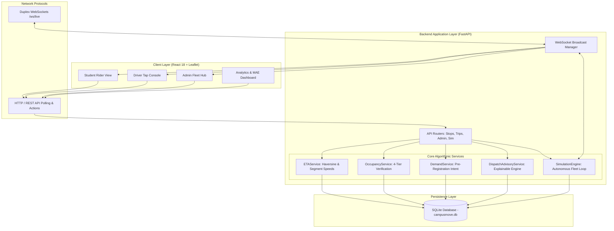

# CampusMove AI — Comprehensive Project Review & Technical Specification
**Smart College Shuttle Transit & Real-Time Demand Management System**  
*Specialized Implementation for Vellore Institute of Technology (VIT), Vellore Campus*

---

## 1. Executive Summary & Problem Statement

### 1.1 The Campus Transit Challenge
University campuses operating internal shuttle systems (such as the sprawling **VIT Vellore** campus) face severe transit bottlenecks during peak hours:
* **"Phantom Shuttles" & Unreliable ETAs**: Fixed timetables disintegrate when class dispersal floods routes. Students have no visibility into vehicle locations or arrival countdowns.
* **Overcrowding & Pass-By Frustration**: Shuttles arrive at stops already 100% full. Waiting students are passed by, having waited needlessly.
* **Lagging & Reactive Dispatching**: Transport supervisors dispatch backup vehicles only after student queues have backed up, lacking predictive demand insights.
* **Substantial Inter-Block Walking Distances**: Walking between distant residential towers and academic zones (e.g., MH Q-T towers to Technology Tower or SJT) can take 15–20 minutes. Students lack real-time distance and time comparisons to decide whether to walk or wait.

### 1.2 The CampusMove AI Solution
**CampusMove AI** is an enterprise-grade, full-stack campus transit and demand management platform engineered to deliver:
1. **Live GPS Tracking & Predictive ETAs** overlaid onto an unwatermarked, high-performance OpenStreetMap canvas of the VIT Vellore campus.
2. **Dynamic 4-Tier Occupancy Sensing** with automatic recommendations for subsequent alternative shuttles when a bus is full.
3. **Student Boarding Pre-Registration** to capture true stop demand *before* students physically crowd the stop.
4. **Explainable AI Dispatch Advisory Engine** that recommends spare vehicle deployments with three explicit, auditable criteria.
5. **VIT Vellore Block Directory** integrating all 22+ Men's & Ladies' Hostel blocks (MH A–T, LH A–J, RGT, Annexes) with official landlines and emails.

---

## 2. Technology Stack & Architectural Specifications

| System Layer | Technology / Framework | Version | Technical Purpose & Value |
| :--- | :--- | :--- | :--- |
| **Frontend Framework** | **React.js (Vite)** | `18.3.1` (Vite `5.4.21`) | Component-driven reactive Single Page Application (SPA) |
| **Frontend Styling** | **Vanilla CSS + Glassmorphism** | Custom CSS3 Tokens | Ultra-modern dark UI, backdrop filters, vibrant color coding |
| **Iconography** | **Lucide React** | `^0.344.0` | Lightweight SVG icons for intuitive transit dashboards |
| **Mapping Engine (GIS)** | **Leaflet.js + React-Leaflet** | `1.9.4` / `4.2.1` | Zero-watermark Leaflet canvas with OpenStreetMap tiles |
| **Backend Framework** | **FastAPI (Python)** | `0.110.0` (Python `3.10`) | High-concurrency asynchronous REST & WebSocket framework |
| **ASGI Server** | **Uvicorn** | `0.28.0` | Asynchronous production-grade server |
| **Database & ORM** | **SQLite + SQLAlchemy** | `2.0.28` | Relational storage for stops, routes, vehicles, trips, and audit trails |
| **Data Validation** | **Pydantic** | `2.6.4` | Strict schema validation for requests and responses |
| **Real-Time Duplex** | **Native WebSockets** | FastAPI WebSocket | Live bi-directional broadcast of moving vehicles and ETAs |
| **Testing Suite** | **Pytest + TestClient** | `8.1.1` | 9 automated end-to-end acceptance tests (100% pass) |

---

## 3. High-Level System Architecture



---

## 4. Complete REST & WebSocket API Specification

### 4.1 Campus Stops & Real-Time Arrivals
* **`GET /api/stops`**
  * *Description*: Retrieves all 10 registered VIT Vellore transit stops with geographic coordinates and sequence hints.
  * *Response*: Array of stop objects (`id`, `name`, `latitude`, `longitude`, `sequence_hint`).
* **`GET /api/stops/hostel-directory`**
  * *Description*: Returns complete directory of VIT Vellore blocks (MH A through T, LH A through J, RGT, Annexes) clustered by transit stops, including building names, landlines, and emails.
* **`GET /api/stops/{stop_id}/arrivals`**
  * *Description*: Returns ordered list of upcoming shuttles arriving at `stop_id`.
  * *Key Attributes*: `eta_seconds`, `eta_formatted`, `distance_meters`, `occupancy_category`, `is_stale`, `is_alternate`.

### 4.2 Fleet Telemetry & Driver Controls
* **`GET /api/vehicles`**
  * *Description*: Returns live operational telemetry for all campus shuttles.
  * *Key Attributes*: `id`, `label`, `lat`, `lon`, `speed_kmh`, `status`, `passenger_count`, `capacity`, `occupancy_category`, `is_stale`.
* **`POST /api/vehicles/{id}/telemetry`**
  * *Description*: Ingests raw GPS updates from on-vehicle tracking hardware or driver mobile devices.
  * *Payload*: `{ "latitude": float, "longitude": float, "speed_kmh": float }`
* **`POST /api/trips/{trip_id}/occupancy-event`**
  * *Description*: Records verified boarding or deboarding events from driver terminal.
  * *Payload*: `{ "event_type": "tap_in" | "tap_out" | "manual_override", "count": int }`

### 4.3 Student Pre-Registration (Demand Prediction)
* **`POST /api/demand/intent`**
  * *Description*: Submits student boarding intent at an origin stop for a target destination block.
  * *Payload*: `{ "user_id": string, "origin_stop_id": string, "dest_stop_id": string }`
* **`GET /api/admin/demand`**
  * *Description*: Aggregates current physical queue plus pre-registered student intent per stop.

### 4.4 Explainable Admin Dispatch & Audit Logging
* **`GET /api/admin/recommendations`**
  * *Description*: Returns AI-recommended dispatch advisories when demand exceeds capacity thresholds.
  * *Payload Output*: `route_id`, `vehicle_id`, `action_type`, `explanation_factors` (3 auditable criteria).
* **`POST /api/admin/recommendations/{id}/action`**
  * *Description*: Records human-in-the-loop admin decision (`accept`, `override`, `dismiss`).
* **`GET /api/admin/audit-logs`**
  * *Description*: Provides an immutable audit trail of all dispatch decisions with timestamps and operator IDs.

### 4.5 Live WebSocket Broadcast
* **`WS /ws/live`**
  * *Description*: Bi-directional WebSocket stream broadcasting fleet state updates every tick.
  * *Message Payload*:
    ```json
    {
      "type": "FLEET_UPDATE",
      "timestamp": "2026-10-23T06:30:00Z",
      "vehicles": [
        {
          "id": "shuttle-1",
          "label": "VIT MH Q-S Express",
          "lat": 12.9752,
          "lon": 79.1646,
          "occupancy_category": "Available",
          "available_seats": 26,
          "is_stale": false
        }
      ]
    }
    ```

---

## 5. Core Mathematical Models & Algorithmic Formulations

### 5.1 Great-Circle Distance (Haversine Formula)
To measure true inter-block distances and shuttle-to-stop spatial gaps along the Earth's curvature:
$$\Delta\phi = \phi_2 - \phi_1, \quad \Delta\lambda = \lambda_2 - \lambda_1$$
$$a = \sin^2\left(\frac{\Delta\phi}{2}\right) + \cos(\phi_1)\cos(\phi_2)\sin^2\left(\frac{\Delta\lambda}{2}\right)$$
$$d = 2 \cdot R \cdot \operatorname{atan2}\left(\sqrt{a}, \sqrt{1 - a}\right) \quad (\text{where } R = 6,371,000 \text{ m})$$

### 5.2 Segment-Based Predictive ETA & Stale GPS Fallback
Rather than using naive Euclidean line speed, ETA sums segment travel times based on historical velocities:
$$\text{ETA}_{\text{seconds}} = \sum_{s \in \text{Segments}} \frac{\text{Distance}_s}{\bar{v}_s} + \sum_{k \in \text{Intermediate Stops}} t_{\text{dwell\_k}}$$
* **Stale Telemetry Threshold**: If $(T_{\text{now}} - T_{\text{last\_ping}}) > 30\text{ seconds}$, the shuttle is marked `is_stale = true`. The interface immediately flags the ETA as approximate to prevent student misguidance.

### 5.3 4-Tier Occupancy State Classification
$$\text{Occupancy Ratio } (r) = \frac{\text{Verified Passengers}}{\text{Total Seating Capacity}}$$
* **Available** ($r < 0.60$): Plentiful seating; students encouraged to board.
* **Filling** ($0.60 \le r < 0.85$): Seats filling steadily; boarding normal.
* **Nearly Full** ($0.85 \le r < 1.00$): Limited standing/seating room remaining.
* **Full** ($r \ge 1.00$): Shuttle fully saturated.
* **Alternative Shuttle Rule**: If the upcoming arrival is **Full**, the system automatically flags the following shuttle as `is_alternate = true`, revealing its ETA and open seating count to prevent crowding onto the full bus.

### 5.4 Explainable AI Dispatch Heuristic Rule Engine
The dispatch advisory engine triggers an alert only when all three verification criteria are satisfied:
1. **Demand Factor**: Stop Queue Demand $\ge 80\%$ of single shuttle capacity.
2. **Capacity Deficit Factor**: Projected arriving capacity within 10 minutes < Waiting demand.
3. **Depot Availability Factor**: Available spare shuttles in Katpadi transit depot > 0.
* **Explainability Guarantee**: Every generated advisory includes three plain-language justifications (e.g., *"Demand of 95 students exceeds threshold by 15; Arriving Shuttle 101 is already at full capacity; Spare Shuttle 104 is idling at Katpadi Depot"*).

---

## 6. VIT Vellore Campus Customization Details

### 6.1 Geographical Alignment
* **Campus Center**: Katpadi, Vellore, Tamil Nadu (`12.9720° N, 79.1610° E`).
* **Campus Transit Perimeter**: Covers South Gate 1 through the MGR Library, Technology Tower, Ladies' Hostel Quadrangle, Men's Hostel Quadrangle, and North High-Rise Towers (MH Q-T).

### 6.2 Clustered Transit Stops (Adjacent Blocks Grouped)
To optimize shuttle cycle time, adjacent blocks are clustered into dedicated stops:
1. **`stop-vit-gate`**: VIT Main Gate 1 (Katpadi Road)
2. **`stop-vit-mb`**: Dr. MGR Block (MB) & Central Library
3. **`stop-vit-tt`**: Technology Tower (TT Academic Block)
4. **`stop-vit-lh-abcdef`**: LH A – F Blocks & Food Park
5. **`stop-vit-lh-ghj`**: LH G, H, J, RGT & GH Annex
6. **`stop-vit-mh-abcdef`**: MH A – F Blocks (Einstein, Ramanujam)
7. **`stop-vit-mh-mnp`**: MH M, N, P Blocks (Darwin, Patel)
8. **`stop-vit-mh-ghjkl`**: MH G – L Blocks (Darling Mess Hub)
9. **`stop-vit-mh-qrst`**: MH Q, R, S, T High-Rise Towers (Vajpayee, Kalam)
10. **`stop-vit-sjt`**: Silver Jubilee Tower (SJT Block)

### 6.3 Official Hostel Directory & Direct Contact Wiring
All 22+ blocks include active telephone links (`tel:0416...`) and email links (`mailto:...`):

| Block Code | Block Namesake | Landline Number | Official Email ID | Clustered Stop |
| :--- | :--- | :--- | :--- | :--- |
| **MH A** | ALBERT EINSTEIN | `0416 220 2531` | `mhablock@vit.ac.in` | MH A–F Stop |
| **MH B** | SWAMI VIVEKANANDA | `0416 220 2532` | `mhbblock@vit.ac.in` | MH A–F Stop |
| **MH B Annex** | SWAMI VIVEKANANDA B ANNEX | `0416 220 2533` | `mhbannex@vit.ac.in` | MH A–F Stop |
| **MH C** | RABINDRANATH TAGORE | `0416 220 2534` | `mhcblock@vit.ac.in` | MH A–F Stop |
| **MH D** | NELSON MANDELA | `0416 220 2535` | `mhdblock@vit.ac.in` | MH A–F Stop |
| **MH D Annex** | NELSON MANDELA D ANNEX | `0416 220 2536` | `mhdannex@vit.ac.in` | MH A–F Stop |
| **MH E** | SIR C.V. RAMAN | `0416 220 2537` | `mheblock@vit.ac.in` | MH A–F Stop |
| **MH F** | RAMANUJAM | `0416 220 2538` | `mhfblock@vit.ac.in` | MH A–F Stop |
| **MH G** | SOCRATES | `0416 220 2539` | `mhgblock@vit.ac.in` | MH G–L Stop |
| **MH H** | JOHN F. KENNEDY | `0416 220 2540` | `mhhblock@vit.ac.in` | MH G–L Stop |
| **MH J** | JOHN F. KENNEDY | `0416 220 2541` | `mhjblock@vit.ac.in` | MH G–L Stop |
| **MH K** | Dr. SARVEPALLI RADHAKRISHNAN | `0416 220 2542` | `mhkblock@vit.ac.in` | MH G–L Stop |
| **MH L** | NETAJI SUBHAS CHANDRA BOSE | `0416 220 2543` | `mhlblock@vit.ac.in` | MH G–L Stop |
| **MH M** | QUAID-E-MILLAT MUHAMMED ISMAIL | `0416 220 2544` | `mhmblock@vit.ac.in` | MH M–P Stop |
| **MH M Annex** | QUAID-E-MILLAT M ANNEX | `0416 220 2545` | `mhmannexblock@vit.ac.in` | MH M–P Stop |
| **MH N** | CHARLES DARWIN | `0416 220 2546` | `mhnblock@vit.ac.in` | MH M–P Stop |
| **MH N Annex** | CHARLES DARWIN N ANNEX | `0416 220 2564` | `mhnannexblock@vit.ac.in` | MH M–P Stop |
| **MH P** | SARDAR PATEL | `0416 220 2547` | `mhpblock@vit.ac.in` | MH M–P Stop |
| **MH Q** | VAJPAYEE BLOCK | `0416 220 2548` | `mhqblock@vit.ac.in` | MH Q–T Stop |
| **MH R** | M. KARUNANIDHI BLOCK | `0416 220 2549` | `mhrblock@vit.ac.in` | MH Q–T Stop |
| **MH S** | ABDUL KALAM BLOCK | `0416 220 2550` | `mhsblock@vit.ac.in` | MH Q–T Stop |
| **MH T** | JAGADISH CHANDRA BOSE BLOCK | `0416 220 2551` | `mhtblock@vit.ac.in` | MH Q–T Stop |
| **LH A** | LADIES HOSTEL A | `0416 220 2669` | `lhablock@vit.ac.in` | LH A–F Stop |
| **LH B** | LADIES HOSTEL B | `0416 220 2670` | `lhbblock@vit.ac.in` | LH A–F Stop |
| **LH C** | LADIES HOSTEL C | `0416 220 2703` | `lhcblock@vit.ac.in` | LH A–F Stop |
| **LH D** | LADIES HOSTEL D | `0416 220 2704` | `lhdblock@vit.ac.in` | LH A–F Stop |
| **LH E** | LADIES HOSTEL E | `0416 220 2705` | `lheblock@vit.ac.in` | LH A–F Stop |
| **LH F** | LADIES HOSTEL F | `0416 220 2706` | `lhfblock@vit.ac.in` | LH A–F Stop |
| **LH G** | LADIES HOSTEL G | `0416 220 2892` | `lhgblock@vit.ac.in` | LH G–J Stop |
| **LH H** | LADIES HOSTEL H | `0416 220 2894` | `lhhblock@vit.ac.in` | LH G–J Stop |
| **LH J** | LADIES HOSTEL J | `0416 220 2896` | `lhjblock@vit.ac.in` | LH G–J Stop |
| **RGT H** | RGT HOSTEL TOWER | `0416 220 5003` | `rgthblock@vit.ac.in` | LH G–J Stop |
| **LH GH** | LH GH (ANNEX) | `0416 220 2244` | `lhghannex@vit.ac.in` | LH G–J Stop |

---

## 7. User Interface & Feature Breakdown

### 7.1 Student Rider View
* **Live Interactive Map**: Real VIT Vellore layout with custom color-coded shuttle markers showing live position, route trajectory, and passenger load.
* **ETA Countdown & Freshness Indicator**: Displays countdown to arrival; transitions to an amber badge if GPS pings exceed 30 seconds.
* **Alternative Shuttle Display**: If the nearest bus is full, the system highlights the next empty shuttle to avoid passenger frustration.
* **Stop Block Contact Panel**: Displays landlines and emails of all buildings corresponding to the currently selected boarding stop.
* **Searchable Block Directory Drawer**: Slide-out drawer to search any block by code, building namesake, or landline extension.
* **Inter-Block Distance & Walk/Ride Estimator**: Dynamic calculation showing exact meters, walking time (at 4.5 km/h), and shuttle travel time (at 17 km/h).

### 7.2 Driver Console
* **Digital Tap-In / Tap-Out**: High-contrast, touch-optimized passenger counter for quick onboarding and deboarding.
* **Door State & Manual Override**: Allows drivers to toggle door sensors and correct passenger counts.
* **GPS Telemetry Simulator**: Allows manual coordinate injection for testing dead zones and route deviations.

### 7.3 Admin Fleet & Demand Hub
* **Real-Time Fleet Grid**: Live status of all vehicles, current route assignment, passenger counts, and telemetry health.
* **AI Dispatch Advisory**: Displays recommendations to deploy spare vehicles, with three auditable explanation factors.
* **One-Click Human-in-the-Loop Actions**: Dispatchers can approve, override, or dismiss recommendations.
* **Immutable Audit Trail**: Logs all system events and operator decisions with timestamps and user IDs.

### 7.4 Analytics & MAE View
* **ETA Accuracy (Mean Absolute Error)**: Tracks prediction performance over time:
  $$\text{MAE} = \frac{1}{n} \sum_{i=1}^n |\text{ETA}_{\text{pred}} - \text{Time}_{\text{actual}}|$$
* **Hourly Demand Curves**: Visualizes morning, afternoon, and evening peak demand patterns.
* **API Latency & WebSocket Health**: Real-time telemetry monitoring server response times.

---

## 8. Five Judge Presentation Scenarios (SRS Sec. 14)

1. **Scenario 1: Normal Loop**
   * Regular fleet headway, balanced passenger loads, green/blue capacity badges.
2. **Scenario 2: Crowd Spike (95 vs 80 Capacity)**
   * Simulates class dismissal surge at MH Q-T / TT.
   * Admin Hub flags critical demand and generates an explainable dispatch recommendation. Dispatching spare shuttle 104 resolves the deficit.
3. **Scenario 3: Stale GPS (>30s Delay)**
   * Simulates telemetry dropouts.
   * UI transitions from green "Fresh" to amber "Stale GPS — ETA approximate".
4. **Scenario 4: Full Bus + Alternative**
   * Upcoming shuttle reaches 100% capacity.
   * System marks it as Full and surfaces the next empty bus as an alternative.
5. **Scenario 5: Zero Spare Bus**
   * All depot backup vehicles are deployed.
   * Advisory intelligently switches to route short-turning rather than requesting unavailable resources.

---

## 9. Model Viva / Review Q&A

**Q1: Why did you choose FastAPI over Flask or Django?**  
> *"FastAPI offers asynchronous execution out of the box, native WebSockets for high-frequency GPS telemetry, automated Pydantic schema validation, and significantly higher throughput with lower latency compared to synchronous WSGI frameworks."*

**Q2: How does your system calculate ETAs when GPS pings are delayed?**  
> *"We use historical segment-based speeds as a fallback. When telemetry exceeds a 30-second staleness threshold, the system flags the ETA as approximate to ensure complete transparency."*

**Q3: How do you prevent phantom wait times when a shuttle is full?**  
> *"Our OccupancyService monitors real-time capacity. When a bus reaches 100%, the backend flags it as Full and promotes the next sequential empty shuttle as a designated alternate."*

**Q4: What is the benefit of Student Boarding Intent over physical tap-ins?**  
> *"Tap-ins only capture students as they step onto the vehicle. Pre-registration gives fleet managers 5–10 minutes of predictive lead time, allowing proactive dispatching before queues overwhelm stops."*

**Q5: Why cluster adjacent hostel blocks rather than creating a stop for each?**  
> *"Stopping every 15 meters at each individual block causes severe campus congestion and increases round-trip cycle times. Clustered hubs optimize transit flow, while our directory provides exact block-level information."*

**Q6: How does the AI advisory engine ensure explainability?**  
> *"Rather than relying on an uninterpretable black-box model, our advisory engine evaluates three verifiable conditions: stop demand deficit, incoming capacity, and depot resource availability, providing clear rationales for every recommendation."*

**Q7: How do you ensure real-time consistency across concurrent users?**  
> *"The backend uses SQLAlchemy transactional consistency coupled with a centralized WebSocket broadcast manager that pushes fleet updates to all connected clients immediately."*

**Q8: Why did you choose Leaflet over Google Maps?**  
> *"Leaflet is open-source, lightweight, requires no API billing keys or quotas, renders without intrusive watermarks, and allows high-performance custom SVG markers and polyline rendering."*

**Q9: How do you evaluate the prediction accuracy of your system?**  
> *"We track Mean Absolute Error (MAE), comparing predicted arrival times against actual stop arrival timestamps recorded in the database."*

**Q10: Can CampusMove AI be scaled to other institutions?**  
> *"Yes. The architecture is completely modular. Updating the seed coordinates, stop definitions, and route polylines allows the platform to be deployed to any campus, airport, or municipal loop."*

**Q11: How does the On-Board QR Code Fare & 24-Hour Penalty System work?**  
> *"Each shuttle features a dedicated scannable QR sticker. When a student boards, scanning the QR records a ₹20 base fare on their digital ledger with a 24-hour payment countdown. If unpaid within 24 hours, the system automatically applies an incremental daily penalty of ₹10 for each day overdue. Students can settle pending dues via UPI or Campus Card with instant receipt generation."*

**Q12: Why is shuttle live tracking dependent on driver registration and duty status?**  
> *"To eliminate ghost transit telemetry and mirror real-world transit operations, tracking only activates when an authenticated driver registers their commercial license credentials and marks themselves 'On-Duty'. If a driver signs off, the vehicle switches to standby mode, preventing misleading ETA broadcasts to waiting students."*

---

## 10. QR Boarding Fare, 24-Hour Grace Window & Daily Penalty Architecture

### 10.1 Feature Workflow & Specifications
1. **QR Scanning Entryway**:
   - Each shuttle vehicle (`Bus 101 MH Q-R-S-T`, `Bus 102 LH`, `Bus 103 SJT-TT`) possesses an authenticated QR identifier (`VIT-SHUTTLE-{vehicle_id}`).
   - Students scan using the built-in animated viewfinder scanner in the web portal or mobile terminal.
2. **Standard Fare Rule**:
   - **Original Cost**: Exactly **₹20 per turn** of shuttle travel.
   - Upon scanning, a ride ticket is generated with `status: "pending"` and `due_at: scan_timestamp + 24 hours`.
3. **24-Hour Payment Deadline & Daily Penalty Formula**:
   $$\text{Days Overdue} = \max\left(1, \left\lceil \frac{\text{Now} - \text{Due At}}{86400\,\text{seconds}} \right\rceil\right)$$
   $$\text{Penalty Amount} = \text{Days Overdue} \times ₹10$$
   $$\text{Total Amount Payable} = ₹20 + \text{Penalty Amount}$$
4. **Presentation Demo Booster**:
   - A dedicated **"Simulate +24h Overdue"** utility enables evaluators to fast-forward time on any active ticket, witnessing the overdue badge and dynamic penalty increment immediately without waiting real days.
5. **Integrated Payment Gateway**:
   - Supports UPI (Google Pay, PhonePe), Campus RFID SmartCards, and NetBanking with verifiable transaction references (`TXN-VIT-XXXXXX`).

---

## 11. Driver Registration Terminal & Duty-Dependent Tracking

### 11.1 Operational Security & Tracking Architecture
1. **Driver Identity Registration**:
   - Drivers register with Full Name, Phone Number, Commercial Driving License (`TN-23-YYYY-XXXXXX`), and Assigned Shuttle Vehicle.
   - Fast demo presets for 1-click evaluation: **Rajesh Kumar (Bus 101)**, **Murugan V (Bus 102)**, and **Kavitha R (Bus 103)**.
2. **On-Duty vs. Off-Duty State Machine**:
   - **ON-DUTY**: GPS coordinates are broadcast every tick over WebSockets; shuttle appears as **"Live In Service"** on the Leaflet map and arrivals board with driver name and badge.
   - **OFF-DUTY**: Telemetry transmission is paused; shuttle marker displays **"⏸️ Awaiting Registered Driver"**, preventing misleading arrival predictions.

---

## 12. V-TOP Institutional Integration & Metro Single-Use Pass Validation

### 12.1 Institutional "Zero-Escape" Account Dues Enforcement
To ensure 100% financial recovery without causing door bottlenecks during peak dispersal hours:
1. **Student Registration Binding**: Every transaction is cryptographically linked to the student's unique university registration number (e.g. `22BCE1042 - Aarav Sharma`).
2. **Official V-TOP Receipts**: Each ride generates an authenticated university fee receipt: `VTOP-TR-2026-XXXXXX`.
3. **Automated Exam Clearance Lock**:
   - If a student carries unpaid transit dues beyond the 24-hour grace window, the system automatically marks their V-TOP transit status as `PAYMENT_HOLD`.
   - On the official V-TOP student portal, this holds the **CAT / FAT Examination Hall Ticket download** and semester course registration until dues are cleared.
   - This provides **100% escape-proof financial accountability** without slowing down vehicle boarding.

### 12.2 Metro Single-Use Boarding Pass (Anti-Fraud Burn Security)
For high-security entry and capacity verification:
1. **Dynamic 1-Time QR Pass**: Students tap **"Issue Single-Use Boarding Pass"** to receive an animated dynamic pass valid for exactly 30 minutes.
2. **Door Scanner Validation**:
   - The Driver Console includes a **Single-Use Door Validator Terminal**.
   - Upon boarding, the driver validates the pass (`POST /api/payments/validate-single-use-pass`).
3. **Permanent Pass Burning (Anti-Screenshot Protection)**:
   - **Scan 1 (Success)**: Server marks `is_single_use_burned: true`, records validation timestamp, driver badge, and **automatically increments the active trip occupancy by +1**.
   - **Scan 2 (Fraud Detection)**: If a student screenshots the pass and sends it to a friend, subsequent scans are immediately rejected with an audio/visual alarm:  
     `❌ REJECTED: Pass was ALREADY SCANNED at [Time]! Single entry exceeded.`


