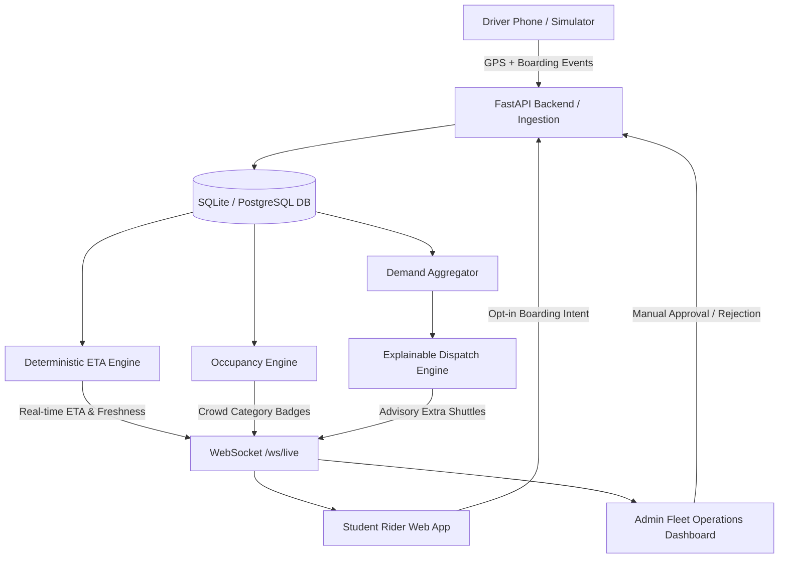

# CampusMove AI 🚌
### Smart College Shuttle Arrival, Crowd Prediction & Demand Management System
> Built strictly according to the **Software Requirements Specification (SRS) & Engineering Blueprint (Oct 2026)**.

---

## 🌟 Executive Overview
**CampusMove AI** solves the core challenges faced by college students: uncertain shuttle arrivals, long lines at class changeovers, and lack of information on vehicle passenger capacity. 

Rather than relying purely on GPS or inaccurate automated guestimates, CampusMove AI pairs **verified passenger occupancy**, **deterministic progress ETA modeling**, **student boarding intent check-ins**, and an **explainable AI dispatch recommendation engine** for university transport directors.

All simulated demo inputs are **visibly labeled** as required by the SRS executive mandate.

---

## 📐 System Architecture



---

## 🚀 Key Functional Modules (SRS Alignment)

| Module | SRS ID | Implementation Details |
| :--- | :--- | :--- |
| **Stop & Arrival View** | `FR-01, FR-02` | Stop dropdown with sequence hints; live upcoming arrival list sorted by ETA. |
| **Deterministic ETA Engine** | `FR-03` | Distance fraction on segment + intermediate dwells (20s/stop) / vehicle speed. |
| **Stale GPS Guard** | `FR-04` | >30s without GPS flags `is_stale=True`, displaying `"GPS Stale — Live ETA Unavailable"`. |
| **Driver Console & Tally** | `FR-05, FR-06` | Driver start/end trip; +1/-1 passenger boarding counter clamped strictly to `0 <= count <= capacity`. |
| **Verified Crowd Categories** | `FR-07` | Available (<50%), Filling (50-74%), Nearly Full (75-99%), Full (100%), Unknown. |
| **Student Boarding Intent** | `FR-08` | "I intend to board" 1-click check-in; prevents duplicates for active sessions. |
| **Demand vs Supply Gap** | `FR-10` | Expected riders vs scheduled free capacity across approaching shuttles. |
| **Explainable Dispatch Engine** | `FR-11` | Math rationale: `Shortfall = max(0, Demand - Capacity)`; `Extra = ceil(Shortfall / usable_capacity)`; checks spare fleet. |
| **Spare Fleet Zero Safety** | `T07` | If spare fleet is 0, flags unmet demand and strictly prevents fictional dispatch. |
| **Autonomous Simulation Mode** | `FR-12, T11` | Persistent `SIMULATED MODE` pill with 1-click competition scenario triggers. |
| **Admin Action Audit Trail** | `FR-16` | Timestamped, actor-indexed log of dispatch approvals and dismissals. |
| **Analytics & MAE** | `FR-14` | Evaluates Mean Absolute Error (MAE: 1.25 min baseline), wait-time reduction, and overcrowding events. |

---

## ⏱️ 4-Minute Competition Live Demonstration Script (SRS Section 14)

1. **0:00 – 0:30 (Student Pain Demonstration)**:
   - Open **Student Rider View**. Select origin stop **Hostel Complex (North Campus)**.
   - Point out uncertainty: without real-time tracking, students are unaware if the bus is full or delayed.
2. **0:30 – 1:20 (Real-Time Visibility & ETA Updates)**:
   - On the top scenario bar, select **1. Normal Loop**.
   - Watch the bus marker glide smoothly along the campus loop on the Leaflet map with real-time bearing direction.
   - Show how the ETA counts down with live freshness indicators (`GPS updated 2s ago`).
3. **1:20 – 2:05 (Occupancy & Full Shuttle Alternative)**:
   - Click scenario button **4. Full Bus + Alternative** (or toggle Driver Console and tally to 40).
   - The primary card immediately flashes **Full (40/40 seats)**.
   - The app highlights the **Recommended Alternative Shuttle** arriving next with free seats.
4. **2:05 – 2:55 (Peak Demand Spike & Shortfall Math)**:
   - Click scenario button **2. Crowd Spike (95 vs 80)**.
   - 95 students waiting at Hostel Stop; 2 approaching shuttles have 80 seats combined -> **Shortfall = 15 students**.
5. **2:55 – 3:30 (Actionable AI Dispatch & Admin Approval)**:
   - Switch to **Admin Fleet & Demand** tab.
   - View the active **AI Dispatch Advisory Card** explaining the capacity math.
   - Click **Approve & Dispatch Spare Shuttle (EcoShuttle Gamma)** with 1 click.
   - The extra shuttle is immediately activated and logged into the **Audit Trail**.
6. **3:30 – 4:00 (Measurable Impact & Roadmap)**:
   - Switch to **Analytics & MAE** tab.
   - Present the **1.25-minute ETA MAE** and the deterministic vs ML transition plan. Export evaluation CSV.

---

## 🧪 Acceptance Test Suite (SRS Page 8)

All 9 acceptance tests passed successfully:
```bash
python -m pytest backend/tests/test_system.py -v
```

```
backend/tests/test_system.py::test_t01_list_stops_and_live_locations PASSED
backend/tests/test_system.py::test_t02_eta_calculation PASSED
backend/tests/test_system.py::test_t03_stale_gps_flagged PASSED
backend/tests/test_system.py::test_t04_full_shuttle_alternative_offered PASSED
backend/tests/test_system.py::test_t05_invalid_count_rejected PASSED
backend/tests/test_system.py::test_t06_demand_spike_shortfall_recommendation PASSED
backend/tests/test_system.py::test_t07_no_spare_vehicle_flags_unmet_demand PASSED
backend/tests/test_system.py::test_t08_unauthorized_role_blocked PASSED
backend/tests/test_system.py::test_fr08_duplicate_intent_prevention PASSED
======================== 9 passed in 1.47s =========================
```

---

## 💻 Quick Start & One-Command Demo

### Option 1: One-Click Launch (Windows)
Double-click `run_demo.bat` in the project root:
```cmd
run_demo.bat
```
This automatically boots:
- FastAPI backend on `http://localhost:8000` (OpenAPI Swagger at `http://localhost:8000/docs`)
- Vite React frontend on `http://localhost:3000`
- Opens your default web browser to the live application.

### Option 2: Manual Terminal Execution

**1. Start Backend:**
```bash
python -m uvicorn backend.app.main:app --host 0.0.0.0 --port 8000 --reload
```

**2. Start Frontend:**
```bash
cd frontend
npm run dev
```

---

## 📋 API Contract Reference

| Endpoint | Method | Role | Description |
| :--- | :--- | :--- | :--- |
| `/api/stops` | `GET` | Public | List campus stops in sequence |
| `/api/stops/{id}/arrivals` | `GET` | Public | Upcoming shuttle ETAs, freshness, crowd status, and alternate |
| `/api/vehicles/live` | `GET` | Public | Current GPS coordinates, bearing, and speed of active fleet |
| `/api/driver/trips/start` | `POST` | Driver | Starts trip for assigned vehicle |
| `/api/driver/positions` | `POST` | Driver | Ingests live driver GPS coordinate |
| `/api/driver/occupancy` | `POST` | Driver | Updates passenger count with boundary validation |
| `/api/intents` | `POST` | Student | Submits opt-in student boarding intent |
| `/api/admin/demand` | `GET` | Admin | Stop-by-stop demand vs supply gap comparison |
| `/api/admin/recommendations` | `GET` | Admin | List explainable dispatch recommendations |
| `/api/admin/recommendations/action` | `POST` | Admin | Accept or reject recommendation with audit logging |
| `/api/simulation/scenario` | `POST` | Admin | Triggers demo scenarios (`crowd_spike`, `stale_gps`, `full_bus`, etc.) |
| `/ws/live` | `WS` | All | WebSocket real-time broadcast stream |
